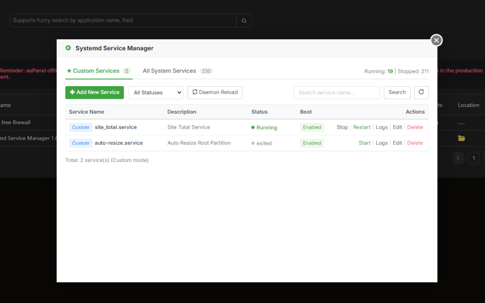
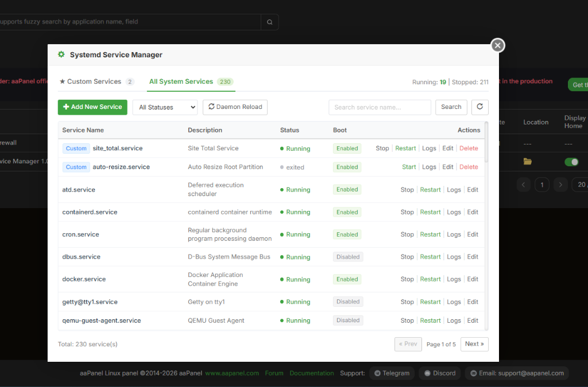
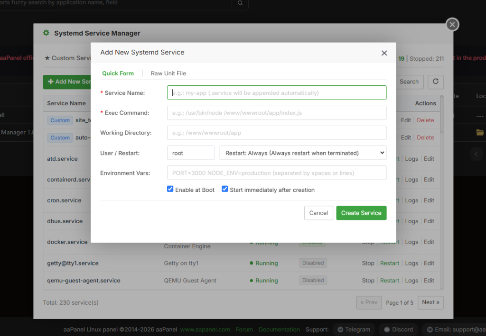
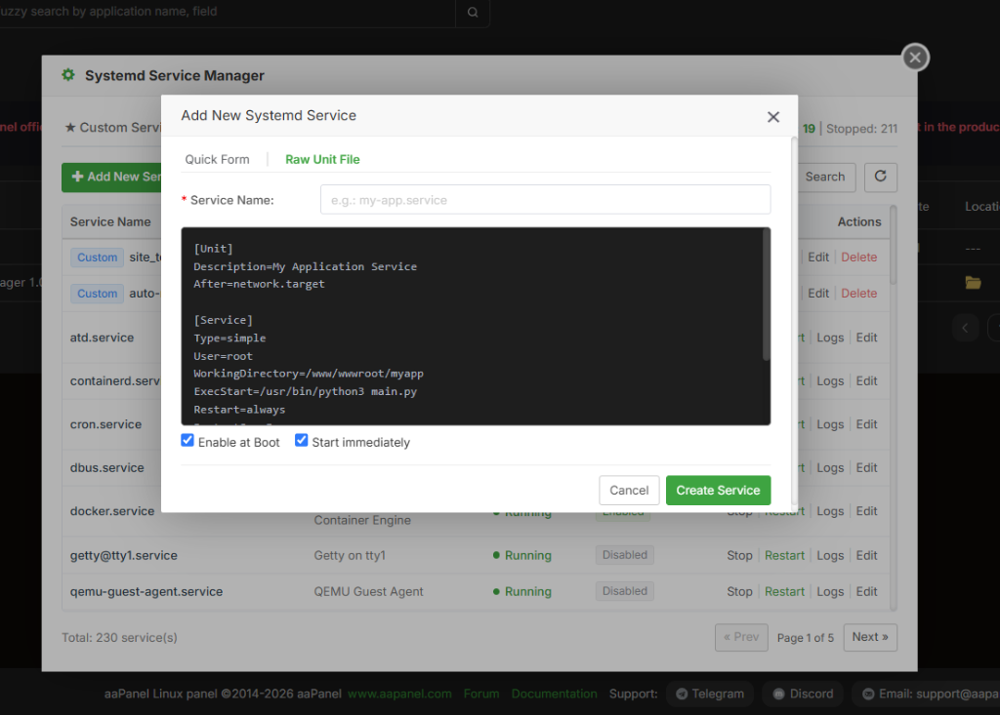

# Systemd Service Manager

An intuitive aaPanel plugin for managing `systemd` services on Linux servers directly through a sleek web interface.

[English](README.md) | [Tiếng Việt](README_VI.md)

[](LICENSE)
[](https://www.aapanel.com/)
[](https://huynhngoanhthai.github.io/Systemd-Service-Manager-1.0/)
[](https://github.com/huynhngoanhthai/Systemd-Service-Manager-1.0)

> 🌐 **Interactive Live Demo:** **[https://huynhngoanhthai.github.io/Systemd-Service-Manager-1.0/](https://huynhngoanhthai.github.io/Systemd-Service-Manager-1.0/)**  
> *Try the interactive simulator directly in your browser before installing on your server!*

---

## 📸 Screenshots

### 1. Custom Services Management
Manage all your custom application services in one place with complete operational controls: Start, Stop, Restart, View Logs, Edit configuration, and Delete.



### 2. All System Services Overview
Monitor more than 200+ Linux system services (Docker, Cron, Nginx, SSHD, etc.), with status badges, instant search, and a handy **Daemon Reload** button.



---

## 🌟 Features

- **Intuitive Service Overview:** Real-time visibility into service status (Running, Stopped, Exited, Failed) and boot persistence (Enabled / Disabled at boot).
- **Smart Separation:** Clear separation between user-created **Custom Services** and internal **All System Services** to prevent accidental modifications to critical infrastructure.
- **One-Click Controls:** Start, Stop, Restart, Reload, Enable, and Disable services instantly.
- **Dual Creation Modes:**
  - **Quick Form:** Fast, guided setup for standard applications (Node.js, Python, Go, Java, bash scripts, etc.).
  - **Raw Unit File:** Full freedom to compose complete `.service` unit files with advanced systemd directives.
- **Log Inspection & Process Metrics:** View service PID, memory footprint, and recent journal log output fetched directly via `journalctl`.
- **Safety First:** Automatic `.bak` backups before modifying unit files, and automatic `systemctl daemon-reload` execution after changes.

---

## 📋 Requirements

- A Linux server running `systemd` (with `systemctl` available).
- **aaPanel** installed.
- Administrative / `root` permissions for aaPanel to manage files under `/etc/systemd/system/`.
- `journalctl` utility for reading system service logs.

---

## 🚀 Installation

### Option 1: Clone from GitHub (Recommended)

Connect to your server via SSH and run:

```bash
sudo git clone https://github.com/huynhngoanhthai/Systemd-Service-Manager-1.0.git \
  /www/server/panel/plugin/service_manager
```

Run the installation script:

```bash
sudo bash /www/server/panel/plugin/service_manager/install.sh install
```

---

### Option 2: One-liner ZIP Installation (No Git required)

Execute the following snippet in your terminal to automatically download the latest archive from the `main` branch and install it:

```bash
sudo bash -c '
set -e
tmp_dir=$(mktemp -d)
trap "rm -rf \"$tmp_dir\"" EXIT
wget -q -O "$tmp_dir/service_manager.zip" "https://github.com/huynhngoanhthai/Systemd-Service-Manager-1.0/archive/refs/heads/main.zip"
unzip -q "$tmp_dir/service_manager.zip" -d "$tmp_dir"
install -d /www/server/panel/plugin/service_manager
cp -a "$tmp_dir/Systemd-Service-Manager-1.0-main/." /www/server/panel/plugin/service_manager/
bash /www/server/panel/plugin/service_manager/install.sh install
'
```

*Note: Ensure `wget` and `unzip` are installed on your server (`yum install -y wget unzip` or `apt install -y wget unzip`). After installation, refresh your aaPanel browser tab (`F5`) to access the plugin in the **App Store**.*

---

## 📖 Detailed Usage Guide

### 1. Managing Services

- **Search:** Enter the service name into the search box in the top-right corner and click **Search** (or press Enter).
- **Filter by Status:** Use the **All Statuses** dropdown to filter services by status (`Running`, `Stopped`, etc.).
- **Quick Actions:**
  - Click **Start** / **Stop** / **Restart** to control the process lifecycle.
  - Click **Logs** to inspect the latest log entries when troubleshooting.
  - Click **Edit** to modify the `.service` configuration file.
  - Click **Daemon Reload** in the top toolbar whenever manual unit changes are made in the system.

---

### 2. Creating a New Service

Click the green **+ Add New Service** button at the top left:

#### Mode 1: Quick Form
Ideal for standard background workers, APIs, and web services (Node.js, Python, Golang, scripts).



1. **Service Name:** Enter your service name (e.g., `my-web-app`). The plugin will automatically append `.service` if omitted.
2. **Exec Command:** Full command to execute your application (e.g., `/usr/bin/node /www/wwwroot/my-app/app.js` or `/usr/bin/python3 /www/wwwroot/api/main.py`).
3. **Working Directory:** Root directory of your application (e.g., `/www/wwwroot/my-app`).
4. **User / Restart:** Execution user (default: `root`) and restart policy (recommended: `Restart: Always` to automatically recover from crashes).
5. **Environment Vars:** Key-value pairs (`KEY=VALUE`) separated by spaces or newlines, e.g., `PORT=3000 NODE_ENV=production`.
6. Check **Enable at Boot** to auto-start on server reboot and **Start immediately after creation** to run right away.
7. Click **Create Service**.

---

#### Mode 2: Raw Unit File
Designed for advanced configurations requiring specific systemd targets, directives, or dependencies (`Type=forking`, `After=network.target mysql.service`, `LimitNOFILE`, etc.).



1. Specify the service name in the **Service Name** field.
2. Type or paste your complete systemd unit file into the code editor.
3. Choose whether to enable at boot and start immediately.
4. Click **Create Service**.

---

## 🗑️ Uninstallation Guide

If you no longer need the **Systemd Service Manager** plugin, you can easily remove it using either method below:

### Method 1: Via aaPanel Web Interface
1. Open **aaPanel**.
2. Navigate to **App Store** -> click on the **Installed** tab.
3. Locate **Systemd Service Manager**.
4. Click **Uninstall** and confirm.

---

### Method 2: Via Terminal / SSH Command
Connect to your server via SSH and execute the uninstallation command:

```bash
sudo bash /www/server/panel/plugin/service_manager/install.sh uninstall
```

Or delete the plugin folder directly:

```bash
sudo rm -rf /www/server/panel/plugin/service_manager
```

> **Important Safety Note on Uninstallation:**  
> Uninstalling the plugin removes only the aaPanel web management interface. All custom systemd services previously created in `/etc/systemd/system/` **will continue to run normally** in Linux without downtime or data loss, unless you explicitly deleted them inside the plugin prior to uninstallation.

---

## ⚠️ Safety Notes

- Restarting or stopping essential system services (e.g., `network`, `sshd`, `mysql`, `nginx`) can disrupt active connections or server availability. Exercise caution when performing actions on system-critical units.
- Clicking **Delete** on a Custom Service immediately stops the service, disables boot auto-start, and permanently removes its unit file from `/etc/systemd/system/`. This action cannot be reversed from the plugin.

---

## 📄 License

Distributed under the [MIT License](LICENSE).
